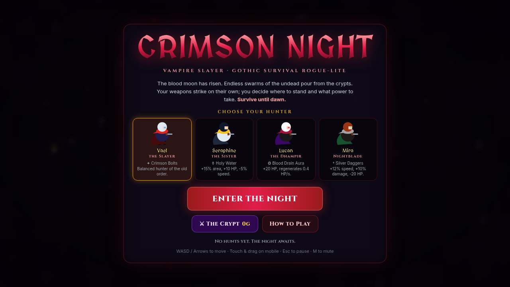
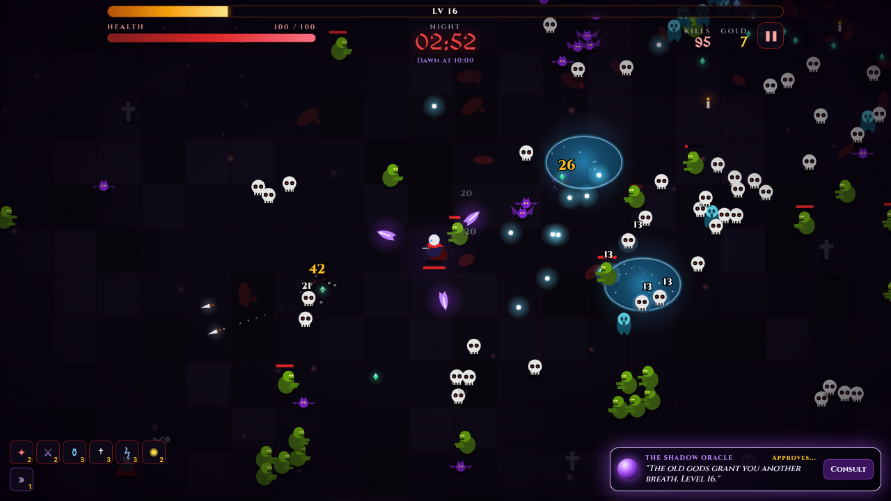
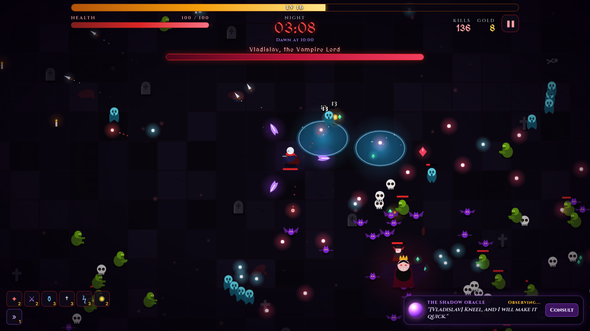

# Vampire Slayer: Crimson Night

A gothic survivor-style browser game. Pick a hunter, survive the night in an endless graveyard, level up your weapons, and outlast three bosses until dawn.

**Play it here:** https://process631.github.io/vampire-slayer/

Or just download `index.html` and open it in any browser. It runs offline, on desktop and mobile.

## Controls
- **Move:** WASD / arrow keys, or touch and drag on mobile (attacks fire automatically)
- **1 / 2 / 3:** pick a level-up card, **R:** reroll
- **E:** consult the Oracle
- **Esc / P:** pause, **M:** mute

## Features
- 4 hunters, 7 auto-firing weapons with evolutions, 9 relics
- 6 enemy types, elites, timed events and 3 bosses
- Survive to 10:00 to win, then keep going in endless mode
- Persistent gold and permanent upgrades in the Crypt shop
- Generated sound effects and music, no external assets

